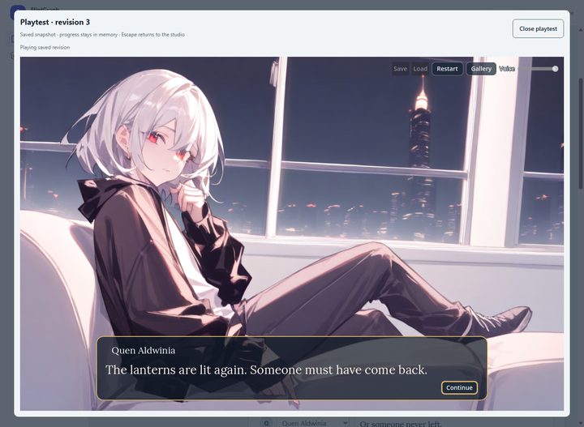
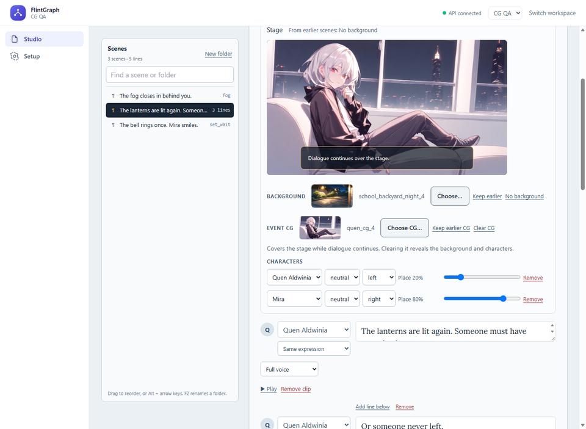
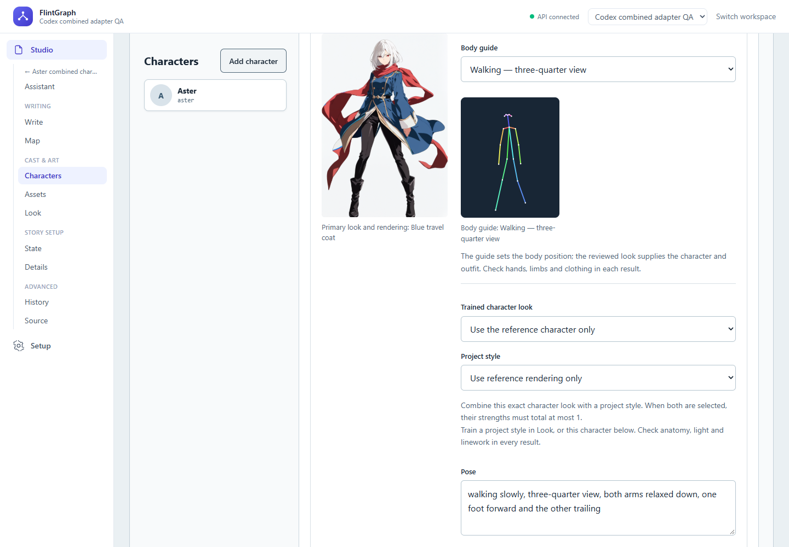

# FlintGraph

FlintGraph is an AI-assisted visual-novel Studio. Write scenes, build branching
choices, stage characters and illustrations, playtest in the browser, and export
an editable Godot/GDScript game.

The creator owns the story. The Assistant proposes changes for review; accepting
a proposal creates a revision. Gameplay follows the authored story and needs no
AI service or FlintGraph account.



*Play a saved story in the browser, with dialogue over a full-screen event CG.*

The local Studio, Godot player, browser playtests and release downloads are
implemented. The project is under active development; the
[roadmap](docs/ROADMAP.md#narrative-game-studio) separates
completed work from the next milestones.

## Make a visual novel

| In the Studio | What you can do |
| --- | --- |
| Assistant | Describe a scene or character, inspect streamed progress, review proposed edits, and accept them into the story. Image suggestions become jobs when you choose Generate. |
| Write and Map | Edit scene scripts, dialogue, choices and state; organize scenes in folders; inspect branching routes. |
| Characters and Assets | Upload art, approve generated candidates, manage backgrounds, sprites, expressions and CGs, and organize the library. |
| Stage and Look | Place and frame characters, change backgrounds and expressions, show full-screen event CGs under the dialogue, and edit the game's theme. |
| Voices | Upload line audio or generate it with a configured local model; choose character voices and per-line delivery. Cloned voices require consented references and applicable license acceptance. |
| Reviewed looks | Lock an approved reference with edited hair, eye and clothing tags; reuse named looks for new requests and save side-by-side character/clothes feedback. Optional clothing-tag comparisons stay advisory. |
| Poses and training | Generate poses from an approved look, choose seated, standing or walking body guides, repair a selected area, and train private character/style versions from reviewed images. |
| Playtest and Releases | Test the saved story in the isolated Godot preview, then build and download a web game or editable Godot source. |

The player supports authored choices and conditions, local saves, voice volume,
and a CG gallery that unlocks illustrations as they are seen. CGs cover the stage
while dialogue continues; clearing them reveals the background and characters
underneath.



*Arrange scenes, set the stage and edit the dialogue in one writing desk.*

Projects keep immutable revisions and recoverable edit conflicts. Uploaded and
generated assets record provenance, hashes, approval and rights declarations.
Releases capture a particular story and its approved assets with versioned build
metadata and notices. Private model weights and Studio look metadata stay out of
the game.

## Run the narrative Studio

You need Python 3.12, [uv](https://docs.astral.sh/uv/), Node.js 20.19+ or 22.12+,
and configured PostgreSQL, MinIO and Temporal services. Docker is used for local
fixtures and isolated release builds. Browser playtests need the verified Godot
engine/templates and a prepared preview build. AI workers additionally need their
separate model installations; authoring with uploaded assets does not require
image or voice generation.

From the repository root, in PowerShell:

```powershell
uv sync --all-groups
npm --prefix frontend ci
Copy-Item tools/narrative/studio.env.example studio.local.env
```

Fill in the new `studio.local.env` using the
[Studio runbook](docs/runbooks/narrative-studio.md#start-everything). It is private
and git-ignored; use your own service settings, model pins, prepared preview and
builder paths. The example is a configuration template, not a ready-made model
installation. Skip the copy step if you already have a local configuration.

Once dependencies and configuration are prepared:

```powershell
uv run python tools/narrative/studio.py check
uv run python tools/narrative/studio.py
```

Open **http://localhost:5173**. The launcher starts the configured containers,
waits for dependencies, applies migrations, and runs the selected API, workers,
relay, preview and frontend. It refuses occupied ports or a stale preview build.
Ctrl+C stops the processes it started. `check` can start configured containers to
check dependencies, but does not launch the Studio processes or apply migrations.

`STUDIO_SERVICES` chooses which processes run. For manual authoring without model
workers, configure the subset described in the runbook. Ollama powers the local
Assistant; image and voice inference run in isolated worker environments.
Downloads, GPU requirements and model/license pins are explicit setup steps.

For a smaller introduction without the Studio services, follow
[play the original sample locally](docs/runbooks/narrative-local-play.md), then
[export and play it in Godot or the browser](docs/runbooks/narrative-web-play.md).

## Models and character consistency

Local image tools include Animagine XL character/background generation, optional
transparent sprite cutouts, face-only expression repainting and reference-guided
CG generation. Poses use a separately installed FLUX.2 klein 4B editing model.
Voice choices and their installation/license requirements are documented in the
[voice runbook](docs/runbooks/narrative-voice-generation.md). Nothing downloads
model weights merely by opening an exported game.

Reviewed looks freeze the words used for new portraits and the approved reference
used for expressions and CGs. A deliberate outfit change gets a new named look.
You still review every candidate: image references do not guarantee identity or
clothing fidelity, especially in two-character CGs. Clothing-tag overlap misses
fine details and does not determine approval.



*Use the approved look for appearance and a body guide for pose geometry.*

The pose workbench supports an additional approved appearance view or a body
guide, local area repairs, and private character/style LoRA versions trained from
explicitly selected, approved images. Character and style versions can be combined
within a bounded strength budget. Training is a local worker job; optional MLflow
tracking records numeric metrics and hashes. Training images and weights stay out
of exported games.

Check anatomy, costume details, linework and lighting before approval. Known
anatomically flawed images are excluded from training, but guides and trained
versions do not guarantee a correct result. Automatic calibrated CCIP identity
scoring, per-character CG scoring and candidate ranking remain unfinished.

See the [body-guide examples and limits](docs/reports/2026-11-02-standing-and-walking-guides.md),
[character/style training](docs/reports/2026-11-02-combined-pose-adapters.md) and
[measurement research](docs/reports/2026-11-01-character-preservation.md).
The screenshots above use qualification fixtures documented in the delivery reports.

## Documentation

- [Studio workflow and local setup](docs/runbooks/narrative-studio.md)
- [Assistant and reviewed proposals](docs/runbooks/narrative-assistant.md)
- [Image generation, expressions, CGs and reviewed looks](docs/runbooks/narrative-image-generation.md)
- [Voice generation and model licenses](docs/runbooks/narrative-voice-generation.md)
- [Godot toolchain](docs/runbooks/godot-toolchain.md) and [player contract](docs/architecture/godot-player-contract.md)
- [Product direction](docs/product/narrative-game-studio.md), [delivery queue](docs/product/narrative-game-backlog.md) and [roadmap](docs/ROADMAP.md)
- [Reviewed prompt catalog and Langfuse setup](docs/runbooks/prompt-management.md)
- [Workspace security](docs/architecture/security-boundary.md) and [deployment hardening](docs/runbooks/deployment-hardening.md)

## Development checks

```powershell
uv run pytest
uv run ruff check .
uv run mypy
$env:FLINT_GRAPH_ENV = "test"
uv run alembic upgrade head --sql
docker compose config
npm --prefix frontend test
npm --prefix frontend run typecheck
npm --prefix frontend run build
```

Default tests use deterministic offline model behavior. Real PostgreSQL, Godot,
browser, worker and model qualification have additional fixtures and opt-in
settings documented in the relevant runbooks and delivery reports. Shared
retrieval services have an additional evaluation gate:

```powershell
uv run flint-graph-eval run --dataset evals/datasets/acme-smoke --evaluations evals/reports/acme-smoke/deterministic-recorded.jsonl --experiment evals/experiments/acme-smoke.yaml --baseline evals/reports/acme-smoke/baselines.json --config-name deterministic
```

## Shared platform services

FlintGraph includes ingestion, extraction, knowledge graph, retrieval and
grounded-answer APIs for document and context workflows.
PostgreSQL is the system of record; MinIO stores immutable artifacts; Temporal
handles durable jobs. Workspace authorization, revision and job boundaries,
storage and observability support the Studio and its shared services.

`docker compose up --build` starts the shared-service stack; the Studio uses
the launcher above. For document workflows, use the
[developer profiles](docs/runbooks/developer-profiles.md),
[local Ollama RAG guide](docs/runbooks/local-ollama-rag.md), and
[service milestone documentation](docs/milestones/). Operational guidance
covers [observability, audit and usage](docs/runbooks/operations-observability.md)
and [backup/restore](docs/runbooks/backup-restore.md).

`X-Tenant-ID` selects a workspace; OIDC authentication and server-side membership
authorize access. Production deployment still requires explicit secrets,
exposure settings, private backing services and operational qualification. See
the security and deployment guides before exposing the API.
