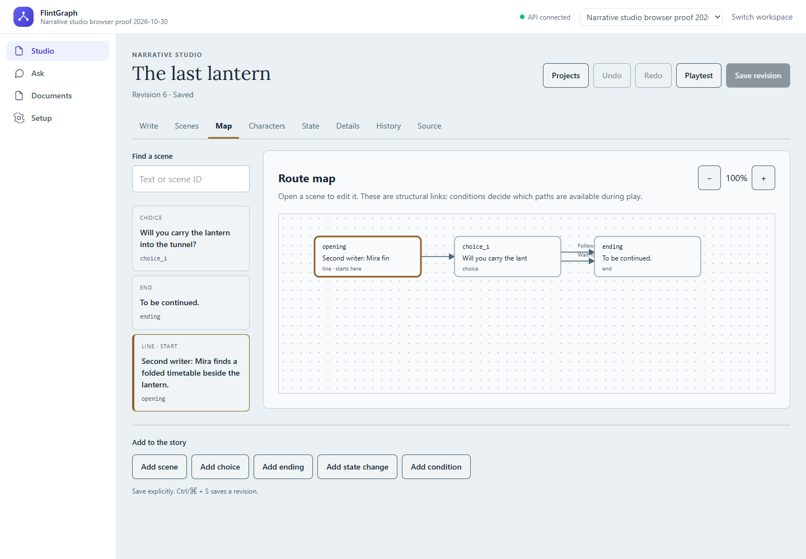
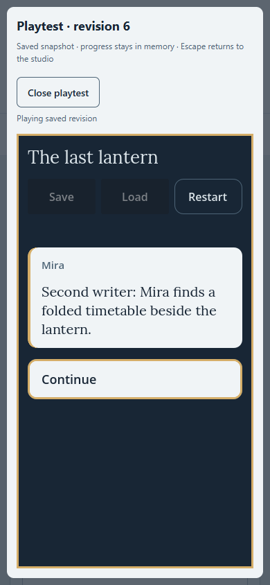
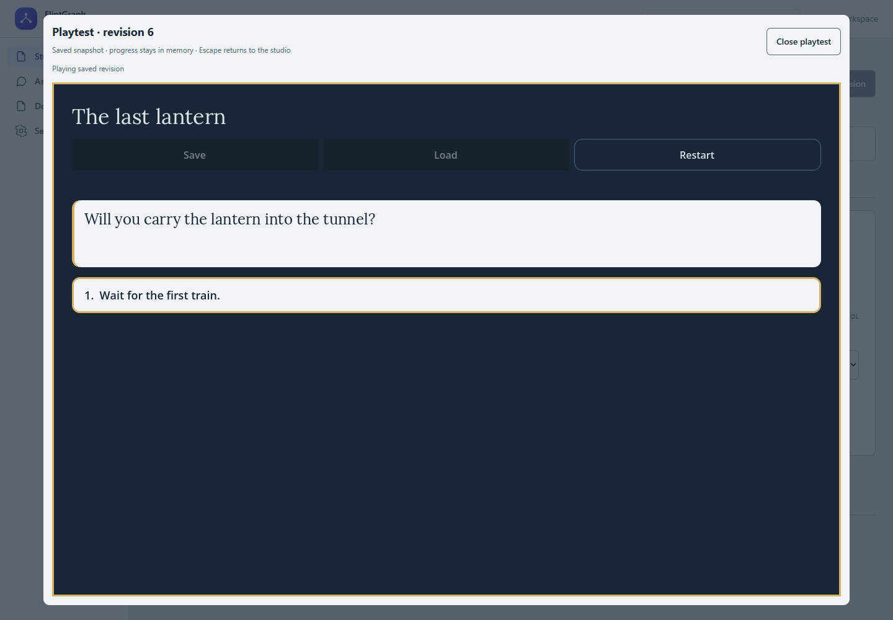

# Manual studio and isolated Godot preview qualification

Scope: M31 #123. Implementation and local live qualification complete; GitHub CI
is pending for the delivery commit. #124 release/build/artifact work remains open.
The existing Q&A pages and unrelated #109 trace work were preserved.

## Delivered behavior

Studio is the default authenticated workspace page. Authors can create/reopen
projects, edit scene narration/speakers/targets, endings, choices and conditions,
characters and bool/int32/enum state, operations and branches. Scene list/form
alternatives accompany a keyboard-navigable route map. Map/list rendering and
undo retention are bounded; warnings identify truncated graph display. Validation
code/location links, exact raw-source preservation, explicit saves, retry identity,
unsaved guards, immutable history inspection and conflict recovery remain visible.

The isolated preview uses the actual shared Godot Player/GameView and an ephemeral
adapter with Save/Load disabled. A pinned explicit build produces a trusted public
artifact containing no creator project. A separate-host server serves verified
immutable bytes only and rejects credentials. The origin/window/nonce-bound
single-load protocol carries source/notices/revision/hash, without application
credentials or API URLs. Strict bounded text validation and package hash checks
precede player construction. General eval is absent from the qualified CSP.

See [design](../superpowers/specs/2026-10-27-narrative-editor-preview-design.md) and
[runbook](../runbooks/narrative-studio.md) for the exact local trust boundary.

## Actual live evidence

Used an owned PostgreSQL 17.10 container, migrated through 0017, and a loopback API
on 8101 with explicit test/dev identity. No existing database, private document,
paid provider or document index was used. The disposable database lost its earlier
fixtures when the host restarted; fresh qualification fixtures were created through
the UI. The active frontend proxies this owned API for testing.

In an isolated Chrome 155 session with localhost/127.0.0.1 restrictions, real inputs:

- Created workspace and *The last lantern*, edited narration, created Mira, a bool
  flag and a two-option conditional choice, connected the opening and saved.
- Reloaded/reopened actual server revisions and inspected older snapshots without
  changing the draft. Duplicate-key source was rejected by the real API and remained
  byte-for-byte visible; undo recovered the prior source.
- Two tabs opened revision 3. One saved revision 4; the stale tab retained its text
  in conflict revision 5. Both versions were inspectable, and explicit copy fetched
  current head 4. A later flag edit saved head 6 while conflict 5 remained recoverable.
- Played saved revisions in actual Godot 4.7.2/WASM under the restrictive CSP at
  `localhost:5173` -> `127.0.0.1:5192`. Revision 3 displayed both choices; changing
  the flag in revision 6 hid the gated first option. Enter/choice key 1 reached the
  ending. Escape closed the iframe and restored focus to Playtest.
- Inspected 1440x1000 and 390x844 screenshots. Mobile outer width remained 390px,
  with a full 619px studio scroll area and 1242px content in the initial writing
  case. No tiny bottom-left scroll pane. Native revision dialogs trap focus;
  map nodes support keyboard selection. Axe reported zero violations/incomplete
  checks on the qualified writing/state views after correcting a region label.
- Captured a real preview navigation with HTTP 200 and neither Cookie nor
  Authorization headers. The server's direct HTTP credential rejection test passed.
  Automatic approval review rejected inserting a synthetic browser cookie, reason
  "blocked by policy"; that particular canary test was not performed or claimed.

The first preview screenshot exposed stale Vite CSS during hot updates; restarting
the owned dev server loaded the current styles, and final mobile/desktop previews
were inspected. The focus-return issue found during the first keyboard pass was
fixed and rechecked. No upstream browser/engine defect is claimed.

[Proof metadata](evidence/narrative-studio-2026-10-30/proof.json) verifies all 13
served file hashes against the retained [build manifest](evidence/narrative-studio-2026-10-30/preview-build.json),
the current API head/conflict records and screenshot hashes. The build helper's
`browser_qualified:false` is its build-only output; the separate live qualification
is recorded here. Source-free engine/template build directories and raw HAR stay
in ignored notes. The report includes no credentials or private corpus.

## Verification

- Frontend `npm test`: **28 passed**, including public editor operations, transport,
  retry/conflict/draft cleanup, bounded history and both protocol sides.
- `npm run typecheck`, `npm run build`: passed; local font and original OFL notice
  are included in the production output, with byte hashes checked.
- `uv run pytest -q --tb=short`: **1229 passed, 44 skipped**, 157.90 seconds. Opt-in
  external/native fixtures were not silently replaced with mocks.
- Actual pinned-engine `test_narrative_preview_live.py` plus direct HTTP
  `test_narrative_preview_server.py`: **2 passed**. The native matrix covers 85
  source/type/condition/hash cases; malformed semantics use independently correct
  raw-source manifest hashes so rejection cannot be attributed to hash mismatch.
- With explicit owned PostgreSQL URL, `test_narrative_projects_api.py`: **27 passed,
  3 skipped**, 15 existing Alembic path-separator deprecation warnings. The three
  skips are PostgreSQL-only cases in the SQLite parameter, not missing PostgreSQL.
- `test_narrative_request_boundary.py` plus preview-server test: **8 passed**.
- `uv run ruff check .`, `uv run mypy` (176 source files), `uv lock --check`, Acme
  deterministic evaluation, `alembic upgrade head --sql` (1116 lines),
  `docker compose config --quiet`, `git diff --check`: passed.
- Reviewer independently passed frontend 28 tests, server test and actual pinned
  Godot validation. Review fixes cover late create/access loss, stale selected-ID
  cleanup, request sequencing and a delayed history-copy race. No material blocker
  remained. No implementation changes were delegated.

Full old Godot export/container qualification was not repeated: its shared runtime
and export implementation were unchanged. The new trusted preview was explicitly
rebuilt and executed. Existing #109 WIP remains unstaged. GitHub CI status will be
recorded after push before closing #123.

## Remaining boundary

Text-only manual authoring and the local separate-host playtest are delivered.
Production HTTPS/cookie-scope hosting, isolated creator-code builds, persistent
release/artifact jobs and hosted asset/AI workflows remain separate work. This is
not a claim of a complete production authoring product. Preview progress stays in
memory; real authoring should use a persistent backend, not the disposable proof DB.
