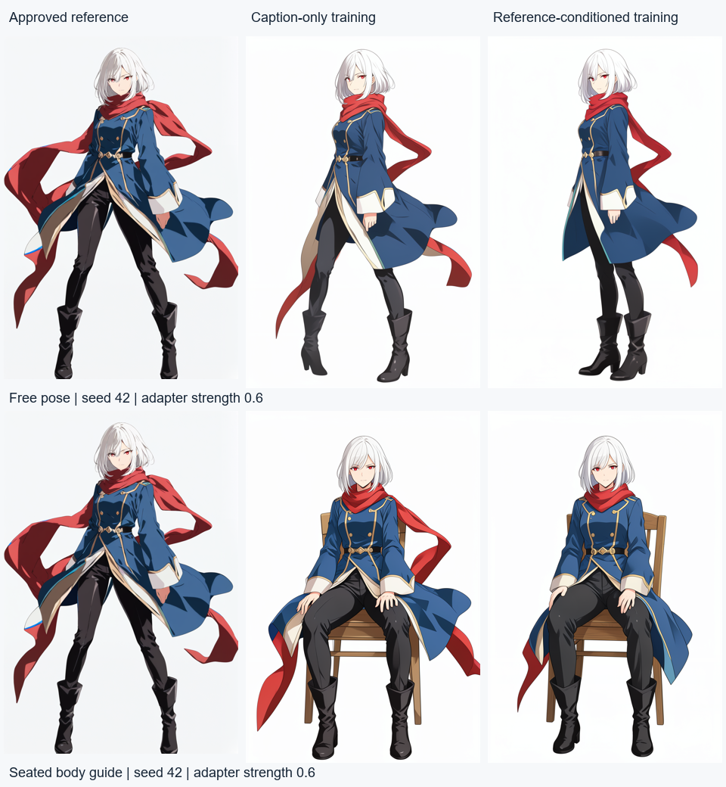

# Reference-conditioned character training

2026-11-04. Delivery for a bounded part of #184; the broader M40 comparison and
creator-calibration criteria remain open. Decision: [ADR 0057](../adr/0057-reference-conditioned-character-training.md).

## Delivered behavior

Character training can explicitly use the approved image as input during learning,
in addition to captions. The API advertises this only under the default-off
`FLINT_GRAPH_NARRATIVE_STYLE_REFERENCE_TRAINING_ENABLED` flag. The character
training form exposes the checkbox and resets rights, same-look and anatomy
confirmations when it changes. History distinguishes the modes. Existing
caption-only jobs, project styles, recipe hashes, replay identities and pose
adapter selection remain valid. No migration, dependency, prompt/policy change
or game-runtime bump is involved.

The registered Temporal activity resolves the approved base by frozen hash,
including reordered datasets. Protocol 2 appends its clean VAE latent to each
noisy target, with separate positional IDs; target tokens alone contribute to
flow loss. The parent checks reference/helper provenance before private weight
publication. Existing scope, approval, anatomy, lease, cancellation, resource and
weight-integrity guards apply to both recipes. The deployed legacy recipe hash is
`262c38600c9b9fa625fbde31c51b5c6b45006496e31bc89d5f759fbefdaa5eb6`;
the new recipe is
`465b266fb274c8156090df113827cafbff709ffc7b1738fac9da59a555f7330b`.

Tests were added before implementation: the initial admission test failed because
the response lacked the mode, protocol 2 was refused by the old child contract,
and parent verification initially accepted a mismatched reference. Tensor checks
use actual pinned Torch/Diffusers and assert clean input values, separate target
and reference IDs, target-only loss and zero gradient for reference predictions.
They complement API/worker tests; finite loss alone does not verify conditioning.

## Real qualification

Only a fresh synthetic Aster project and four manually reviewed training sources
were used: approved base, rear view, seated replacement and wave. The earlier
extra-leg result was explicitly excluded by hash. These are agent observations,
not creator ratings or an independent quality dataset. Real projects were neither
opened nor modified. The task used separate API/worker queues and its own database
on the owned test PostgreSQL instance.

A 20-step registered reference run passed in **90.312 s**, followed by a
200-step run in **371.703 s**. Both peaked at **8,729,595,392 bytes (8.13 GiB)**
of Torch allocation on the 12 GiB RTX 5070 Ti laptop GPU. The actual clean
reference was **336 × 512**. Windows host-memory and dedicated-GPU admission
remained at 6 GiB and 11 GiB free respectively; the idle main Studio was paused
for qualification. One clean WSL filesystem-cache drop returned unused cache to
Windows without stopping containers or altering their data. An HTTP polling
connection failed mid-run; resuming polling of the admitted ID confirmed the same
job completed, without resubmission.

The caption-only 200-step comparison completed in **263.921 s**, peaking at
**8,448,426,496 bytes (7.87 GiB)**. Both jobs used seed 42 and exactly the same
frozen four-image dataset hash. Reference conditioning took **40.8% longer** in
this pair. Each job has its own trigger word; this and a single training seed
limit causal comparisons. [Training receipts](reference-training-2026-11-04/training.json)
retain all losses, source/caption hashes, model/recipe/helper pins and resource
measurements. Loss is not a visual-quality score.

The actual browser checked the default unchecked option, selection of all four
images, reset of all three confirmations when enabling the mode, disabled
submission afterward, and old/new history labels. Scoped axe 4.12.1 checks found
zero violations and zero incomplete checks on desktop and phone. At 390 px,
viewport and document widths were both 390.
[Desktop](reference-training-2026-11-04/studio-desktop.png),
[phone](reference-training-2026-11-04/studio-mobile.png),
[confirmation state](reference-training-2026-11-04/confirmation-state.json),
[desktop audit](reference-training-2026-11-04/desktop-a11y.json),
[phone audit](reference-training-2026-11-04/mobile-a11y.json).

Four native-parent renders compare both 200-step versions at strength **0.6**,
seed **42**, the same approved base, pose text and pinned model: a free
three-quarter turn and `seated-front-v1`. Both recipes retain broad hair/eye/outfit
features and show two legs and boots. Both still alter costume trim, framing and
linework; the free outputs do not fully perform the requested over-shoulder turn.
The seated pair has no obvious missing/extra leg, but fingers and chair details
remain subject to creator review. No candidate was approved. This is two matched
cases with one seed, not a calibrated quality comparison or demonstrated win.
No CCIP/tagger scores or creator ratings were collected in this delivery.



[Complete output images and runtime receipts](reference-training-2026-11-04/comparison.json)
retain all four results. Guided inference places appearance after the body
reference, so it is an explicit compatibility check beyond the training recipe's
single-reference layout.

A separate real HTTP → registered Temporal pose worker → private-store run used
the new character version with `walking-three-quarter-v1` and background removal.
It completed in **67.296 s** and recorded the exact trained weights hash in output
provenance. The [transparent candidate](reference-training-2026-11-04/worker-walking.png)
has visible edge fringing after cutout and remains **unapproved**; successful job
execution is not a visual-quality pass.
[Worker receipt](reference-training-2026-11-04/worker-pose.json).

The main Studio was restored with its original queues, model pins and data; only
the new optional capability flag was added to its private profile. API 8101,
frontend 5173 and preview 5192 returned 200. The option remains unchecked for new
forms. Capability was checked using an owned synthetic fixture, without opening
real projects. [Rollout receipt](reference-training-2026-11-04/rollout.json).

## Reproduction and checks

Live helpers are private scratch programs under ignored `notes/`; they read only
the synthetic fixture/configuration and retain bounded receipts. Public report
artifacts contain no credentials, private storage keys or real project data.

Live commands:

```powershell
uv run python tools/narrative/studio.py --config notes/studio-reference-training.env
uv run python notes/prepare-reference-fixture.py
uv run python notes/qualify-reference-training.py 20
uv run python notes/qualify-reference-training.py 200
uv run python notes/resume-reference-training.py
uv run python notes/qualify-reference-comparison.py
uv run python notes/qualify-reference-worker-pose.py
uv run python tools/narrative/studio.py --config notes/studio-reference-ui.env
uv run python tools/narrative/studio.py --config notes/studio-active.env
uv run python notes/qualify-reference-main.py
npx --yes agent-browser --session reference-f68874d5b506 a11y --selector '.style-studio' --json
```

The first 200-step polling command ended with `httpx.ReadError`; the resume
command verified completion of that existing job. The comparison helper executes
`uv run python notes/qualify-caption-training.py 200` before its four fixed-seed
native-parent renders. No failed training run was replaced or hidden.

Required checks passed before commit. [Exact argv and timings for all 17
commands](reference-training-2026-11-04/verification.json) include the complete
PostgreSQL file list and isolated-runtime Python paths. The wrapper was
`uv run python notes/verify-reference-precommit.py`, with `FLINT_GRAPH_ENV=test`.

| Check | Result |
| --- | --- |
| `uv run pytest -q --tb=short` | 2,040 passed, 124 conditional live tests skipped |
| Fresh owned PostgreSQL helper, 23 integration files | 323 passed, 1 conditional skip; head → 0032 → head passed |
| Real Godot: `uv run pytest tests/integration/test_narrative_godot_live.py tests/integration/test_narrative_preview_live.py tests/integration/test_narrative_event_cgs_live.py -q --tb=short` | 33 passed, 1 owned-builder release test skipped |
| `uv run ruff check .` | Passed |
| `uv run mypy` | 299 modules passed |
| `uv run alembic upgrade head --sql` | Passed |
| `docker compose config` | Passed |
| `npm test --prefix frontend` | 141 passed |
| `npm run typecheck --prefix frontend` | Passed |
| `npm run build --prefix frontend` | Passed |
| `uv run flint-graph-prompts check --base-ref origin/master` | Passed |
| `uv run flint-graph-eval run --dataset evals/datasets/acme-smoke --evaluations evals/reports/acme-smoke/deterministic-recorded.jsonl --experiment evals/experiments/acme-smoke.yaml --baseline evals/reports/acme-smoke/baselines.json --config-name deterministic` | Passed |
| `uv run python -m unittest discover -s runtimes/stylegen -p test_contract.py` | 4 passed |
| `uv run python -m unittest discover -s runtimes/posegen -p test_contract.py` | 9 passed |
| Isolated stylegen `python -m unittest discover -s runtimes/stylegen -p test_conditioning.py` | 1 real tensor test passed |
| Isolated posegen `python -m unittest discover -s runtimes/posegen -p test_repair.py` | 2 passed |
| Isolated posegen `python -m unittest discover -s runtimes/posegen -p test_guidance.py` | 1 passed |

Godot used `FLINT_GRAPH_NARRATIVE_GODOT_BIN` set to
`C:/Projects/flint-graph/notes/toolchains/godot-4.7.2/engine/Godot_v4.7.2-stable_win64.exe`
and its pinned templates. No new release build was run: this delivery changes
private training, not story packages or exported runtimes. Real GPU qualification
above supplements the default suite's opt-in skips. PostgreSQL was isolated;
owned production/development fixture data and containers were preserved.

The underlying conventions were checked against the installed **Diffusers 0.42.1**
`pipeline_flux2_klein.py`, rather than adopting a future main-branch recipe.
Upstream context: [Diffusers FLUX.2 documentation](https://huggingface.co/docs/diffusers/api/pipelines/flux2)
and the [official FLUX.2 inference repository](https://github.com/black-forest-labs/flux2).
